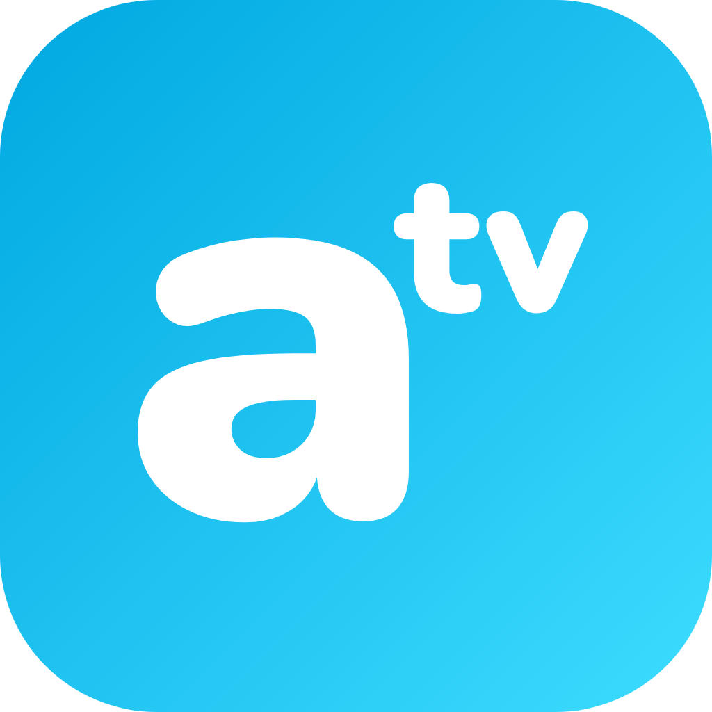
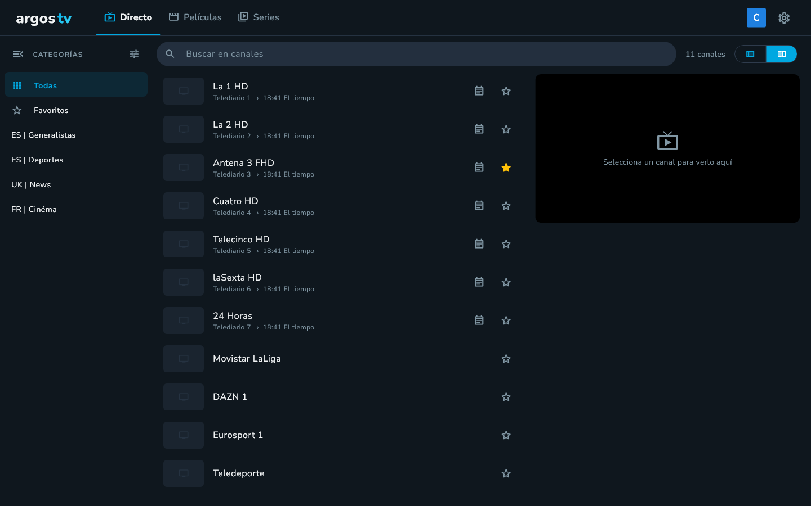
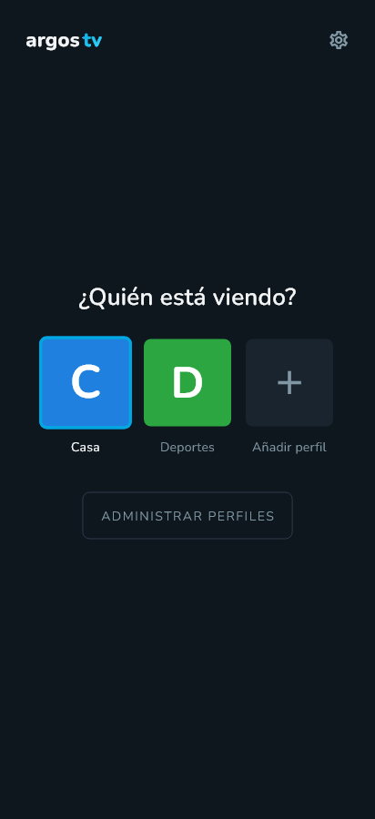
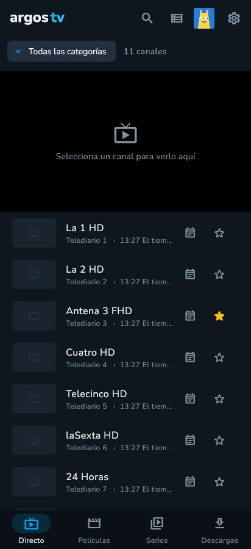
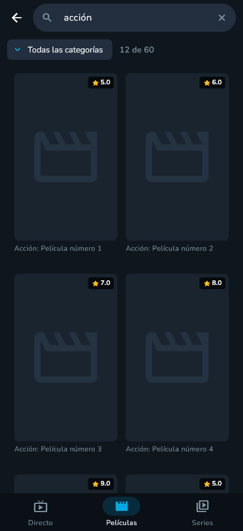
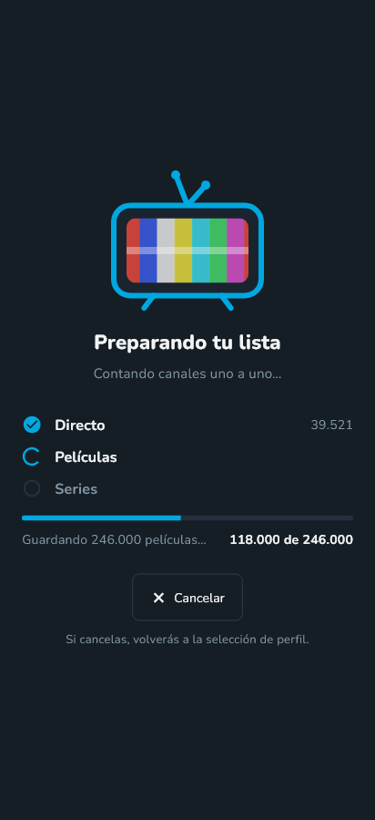
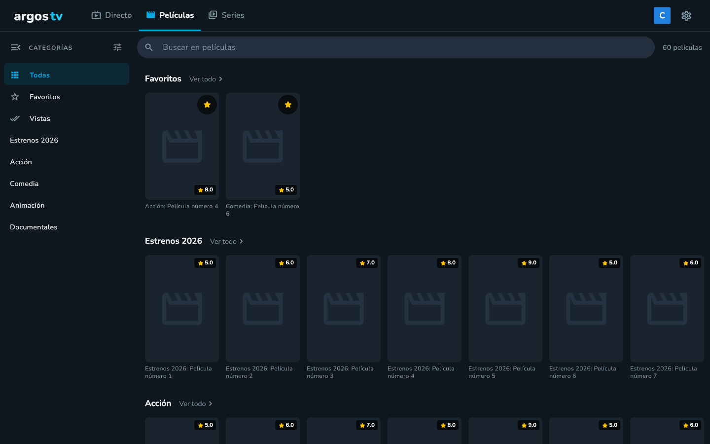

  

  

  <b>Reproductor IPTV ligero para móvil, televisión y ordenador.</b> 
  Directo, películas y series de tu lista Xtream Codes o M3U, con guía de programación 
  y perfiles al estilo Netflix. Gratis y sin anuncios.

  
  
  
  

  Enlaces cortos para compartir o escribir en la tele: <a href="https://bit.ly/argos-tv-android">bit.ly/argos-tv-android</a> · <a href="https://bit.ly/argos-tv-android-tv">bit.ly/argos-tv-android-tv</a> · <a href="https://bit.ly/argos-tv-win">bit.ly/argos-tv-win</a>

  Todas las versiones y arquitecturas en <a href="https://github.com/davidmarquesrodriguez/argos-tv-releases/releases">Releases</a>.

  

> [!IMPORTANT]
> ARGOS TV es **solo un reproductor**: no incluye, vende ni enlaza ningún canal ni contenido. Necesitas tu propia lista de un proveedor legal y eres responsable de lo que reproduces.

## ✨ Qué ofrece

- 📺 **Directo** con logo, programa actual y siguiente, guía completa por canal y **vista previa** que pasa a pantalla completa sin cortes.
- 🎬 **Películas y series** con portada por categorías, fichas, temporadas y episodios.
- ⏯️ **Continuar viendo** y **Vistas**: retoma cada película o episodio donde lo dejaste.
- 🔎 **Búsqueda instantánea** dentro de la categoría que estás viendo.
- 👥 **Perfiles** con su propia lista, favoritos e historial.
- 🌍 Español, català, English y français.
- 🔒 Sin cuentas, sin anuncios y sin telemetría. Tu contraseña se guarda en el almacén seguro del sistema.

<table>
  <tr>
    <td></td>
    <td></td>
    <td></td>
    <td></td>
  </tr>
</table>

  

## 📺 ¿Funciona en mi tele?

> **La prueba rápida:** si tu tele tiene la tienda **Google Play** o es un **Fire TV**, ARGOS TV funciona. Si no, conecta un Google TV o Fire TV al HDMI y listo.

<table>
  <tr>
    <th width="50%">✅ Funciona Android TV · Google TV · Fire TV</th>
    <th width="50%">❌ No funciona sistemas propios del fabricante</th>
  </tr>
  <tr>
    <td align="center" valign="top">
       
      
      
      
      
      
      
      
      
      
      
        
      <b>Dispositivos para el HDMI</b>  
      
      
      
      
        
      * Según el modelo: comprueba que tenga Google Play o sea Fire TV.
    </td>
    <td align="center" valign="top">
       
      
      
      
      
      
      
        
      <b>💡 Solución:</b> conecta un <b>Google TV</b> o un <b>Fire TV Stick</b> al HDMI de la tele (desde unos 30 €) e instala ARGOS TV en él.
        
      Una versión nativa para Samsung y LG está en estudio.
    </td>
  </tr>
</table>

## 📲 Cómo instalar

### Android (móvil o tablet)
1. Descarga **`ARGOS-TV-android-arm64-v8a.apk`** desde el móvil: abre **[bit.ly/argos-tv-android](https://bit.ly/argos-tv-android)**. Si tu móvil es antiguo (32 bits), usa `armeabi-v7a`.
2. Ábrelo y permite **«Instalar apps desconocidas»** cuando lo pida.

### Android TV / Google TV
Muchas teles usan Android de 32 bits: descarga **`ARGOS-TV-android-armeabi-v7a.apk`** ([bit.ly/argos-tv-android-tv](https://bit.ly/argos-tv-android-tv)).

- **Con la app Downloader** (Google Play): activa *Fuentes desconocidas* para Downloader en *Ajustes → Apps → Seguridad y restricciones* y escribe **`bit.ly/argos-tv-android-tv`**.
- **Desde el ordenador** con ADB: activa las opciones de desarrollador en la tele (pulsa 7 veces *Ajustes → Sistema → Información → Compilación*) y la depuración, y ejecuta `adb connect IP-DE-LA-TELE` y `adb install ARGOS-TV-android-armeabi-v7a.apk`.

> Las teles Samsung (Tizen) y LG (webOS) no usan Android: conecta un dispositivo Google TV o Fire TV al HDMI.

### Windows 10/11
Descarga **`ARGOS-TV-windows-x64.zip`** ([bit.ly/argos-tv-win](https://bit.ly/argos-tv-win)), descomprímelo en una carpeta y abre **`argos.exe`**.

### macOS
Descarga **`ARGOS-TV-macos.zip`** y descomprímelo. La app no está firmada por Apple: la primera vez ábrela con **clic derecho → Abrir**. *Versión sin probar todavía.*

## 🆕 Novedades
Cada versión, con sus cambios, está en [Releases](https://github.com/davidmarquesrodriguez/argos-tv-releases/releases).

## 📄 Licencia
© 2026 David Marqués Rodríguez. Todos los derechos reservados. Puedes instalar y usar las versiones publicadas aquí para uso personal y no comercial. El código fuente no es público.

## ❤️ Apoya ARGOS TV

  

  

